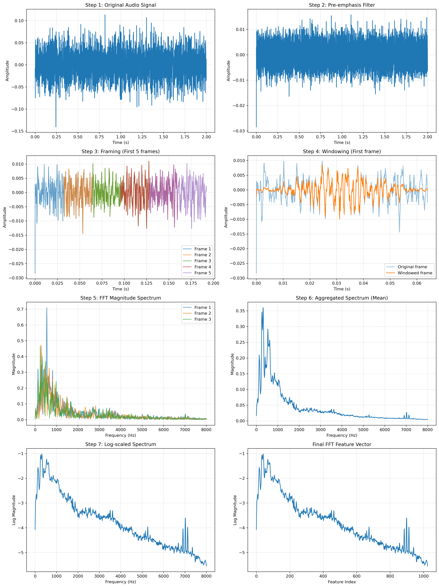

# Queenless Bee Hive Detection from Sound

Detecting whether a honey-bee colony has lost its queen — using only audio recorded inside the hive. A queenless colony declines quickly unless the beekeeper intervenes, and opening hives to check is slow and disturbs the bees.

This project shows that carefully engineered **classical spectral features + PCA + SVM** reach **99.38 % accuracy** on queen / no-queen classification, improving on the best previously reported result on the same dataset (96.70 %, low-frequency STFT + KNN; earlier baseline 91.75 % with MFCC + KNN).

Research carried out at the AI Department, FPT University, with Assoc. Prof. Phan Thi Thu Hong.



## Method

1. **Preprocessing** — pre-emphasis, framing and windowing before each transform (the "s" variants below: FFTs, STFTs, CQTs).
2. **Feature extraction** — FFT, STFT and Constant-Q Transform (CQT) spectra, log-scaled and pooled over time.
3. **Feature fusion** — concatenating complementary linear (FFT/STFT) and logarithmic (CQT) frequency views.
4. **Dimensionality reduction** — PCA applied per feature family before fusion.
5. **Classifiers** — KNN, SVM (RBF), Random Forest and Extra Trees with hyper-parameter search.

## Results

| Dataset | Task | Best features | Features | SVM accuracy |
|---|---|---|---|---|
| Dataset 1 — 20,000 clips | Queen / NonQueen | PCA(FFTs) + PCA(CQT) + PCA(STFT) | 2,402 → 290 | **99.38 %** |
| Dataset 2 — 13,792 clips | Bee / NoBee / NoQueen | PCA(FFTs) + PCA(CQT) | 341 → 246 | **89.60 %** |

Key findings:

- Preprocessing matters more than the transform: plain FFT reaches ~74 % on Dataset 1, the preprocessed **FFTs reaches 97.82 %** with the same classifier.
- Fusing linear and logarithmic frequency features beats every single feature set (98.67 % for FFTs + CQT).
- PCA cuts the fused vector by **87 %** while *raising* accuracy, keeping inference cheap.

Both datasets use an 80 / 20 train–test split.

## Repository

```
notebooks/
  dataset1_binary.ipynb       full experiment grid for Queen / NonQueen
  dataset2_multiclass.ipynb   full experiment grid for Bee / NoBee / NoQueen
feature_extraction/           notes (Vietnamese) and a notebook on FFT, STFT, CQT, MFCC, chroma, spectral contrast
scripts/
  hold_out_split.py           train / val / test split of the class folders
  fft_pipeline_visualization.py
assets/                       figures
```

## Running

```bash
pip install -r requirements.txt
python scripts/hold_out_split.py --data_dir <audio_root> --categories bee nobee noqueen --split_ratio 0.7 0.1 0.2
```

Then open the notebooks and point the dataset path in the first cells to your local copy of the audio. Audio files and extracted feature caches (`*.wav`, `*.npy`, `*.pkl`) are not included.
